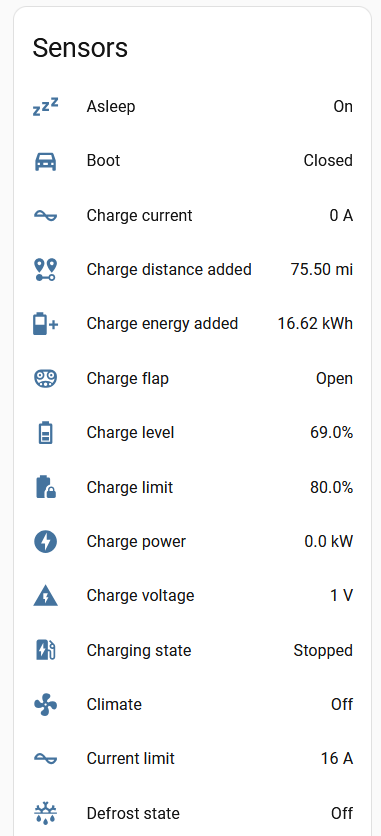
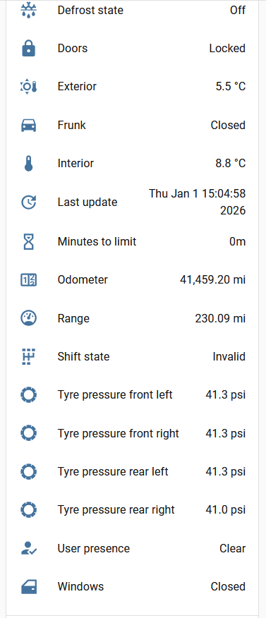
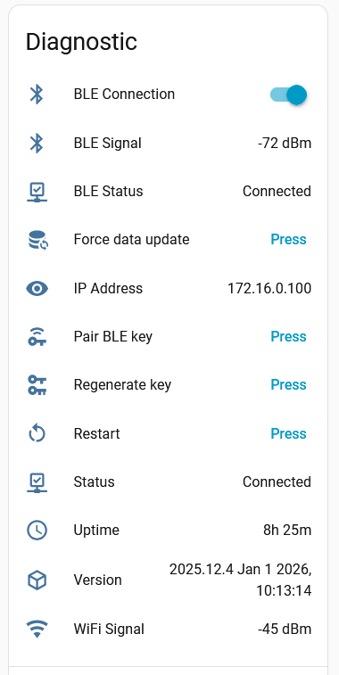

# ESPHome Tesla BLE

[![GitHub Release][releases-shield]][releases]
[![GitHub Activity][commits-shield]][commits]
[![Last Commit][last-commit-shield]][commits]
[![Platform][platform-shield]](https://github.com/esphome)

Control and monitor a Tesla over Bluetooth Low Energy from an ESP32, with native Home Assistant entities via ESPHome.

This is the **Jabe** hard fork of the project ([Jabe/esphome-tesla](https://github.com/Jabe/esphome-tesla)). Historical origin: yoziru → community forks; the BLE protocol library [PedroKTFC/tesla-ble](https://github.com/PedroKTFC/tesla-ble) is vendored in `components/tesla_ble_vehicle` (see [`TESLABLE.md`](./components/tesla_ble_vehicle/TESLABLE.md)). This tree is maintained independently with modular packages (Ethernet, Wi‑Fi, optional Fleet API).

| Controls | Sensors-1 | Sensors-2| Diagnostic |
| - | - | - | - |
|  |  |  |  |

## Contents

- [Quick start](#quick-start)
- [Packages](#packages)
- [Versions and pinning](#versions-and-pinning)
- [Features](#features)
- [Fleet API emulation and evcc](#fleet-api-emulation-and-evcc)
- [Hardware](#hardware)
- [If it doesn't build](#if-it-doesnt-build)

## Quick start

1. Check the [pre-requisites](#pre-requisites) and pick your [hardware](#hardware).
2. Fill in [secrets and the BLE MAC](#secrets-and-ble-mac).
3. Start from [`tesla-ble.example.yml`](./tesla-ble.example.yml) (remote packages) or [`tesla-ble.local.yml`](./tesla-ble.local.yml) (local checkout), then [build and flash](#building-and-flashing).
4. Add the device to [Home Assistant](#home-assistant).
5. [Pair the BLE key](#pairing-the-ble-key) with the car.

### Pre-requisites

**Recommended:** Home Assistant [ESPHome Device Builder](https://esphome.io/guides/getting_started_hassio#installing-esphome-device-builder)

**CLI:** Python 3.10+, GNU Make (optional wrapper)

**ESPHome version:** no strict minimum — the version pinned in `requirements.txt` is only what CI builds against. Confirmed working down to 2026.6.5; the esp-idf `advanced:` example (`sram1_as_iram`) needs ≥ 2026.4.0.

### Secrets and BLE MAC

Packages never reference `!secret` themselves — your node config supplies the values (via top-level `substitutions` or package `vars`), so secret names are entirely yours. The example config maps them like this — copy `secrets.yaml.example` → `secrets.yaml` and set at least:

- `api_encryption_key`
- `ble_mac_address`, `tesla_vin`
- For Wi‑Fi: `wifi_ssid`, `wifi_password`
- Optional: `ota_password` (OTA auth is off unless you set the `ota_password` substitution)

**VIN** is on the windscreen / Tesla app — not the BLE advertisement name.

Find the BLE MAC with a phone BLE scanner near the car (name often starts with `S`), or flash [`ble-scanner.yml`](./ble-scanner.yml) and watch the logs.

Optional: include `features/listener.yml` with your VIN to log the matching MAC from ESPHome.

### Building and flashing

#### Recommended (HA Device Builder)

1. Create a new device from [`tesla-ble.example.yml`](./tesla-ble.example.yml).
2. Choose Wi‑Fi or Ethernet package; include or drop `fleet_api`.
3. Install / OTA from the builder UI.

#### Local checkout

```sh
cp secrets.yaml.example secrets.yaml
# edit secrets
make deps
make compile TARGET=tesla-ble.local.yml
make upload TARGET=tesla-ble.local.yml
```

Or: `esphome run tesla-ble.local.yml`

### Home Assistant

1. Settings → Devices & Services → add ESPHome (or accept discovery).
2. Enter the API encryption key from `secrets.yaml`.

### Pairing the BLE key

1. ESP near the car; correct `ble_mac_address` and `tesla_vin`.
2. Sit in the vehicle; press **Pair BLE key** on the device in HA.
3. Tap your NFC card on the console; confirm the pair prompt on the car screen.
4. Under Controls → Locks you should see a new key (rename e.g. to “ESPHome BLE”).


## Packages

Configs are small **composable packages** — not one mandatory base that hard-codes Wi‑Fi or Ethernet. Your node YAML is a shopping list.

### Layout

```
packages/
├── core/
│   ├── base.yml           # esphome, logger, api, ota, external_components
│   ├── ble_tracker.yml    # esp32_ble_tracker
│   └── diagnostics.yml    # uptime, status, BLE presence, restart
├── connectivity/
│   ├── wifi.yml
│   └── ethernet-lan8720.yml
├── features/
│   ├── vehicle.yml        # BLE client + vehicle sensors/controls
│   ├── fleet_api.yml      # optional Fleet API HTTP server (evcc etc.)
│   ├── listener.yml       # optional VIN BLE MAC discovery
│   ├── language_de.yml
│   └── language_hu.yml
└── boards/
    ├── esp32dev.yml
    ├── m5stack-atoms3.yml
    └── m5stack-nanoc6.yml
```

### Minimal shopping list

| Package | Required? | Role |
| --- | --- | --- |
| `core/base.yml` | yes | Identity, logger, API, OTA, component sources |
| board package | yes | `esp32` board / flash / framework |
| `connectivity/wifi` **or** `ethernet-lan8720` | yes (one) | Network |
| `core/ble_tracker.yml` | yes for vehicle/listener | BLE scan |
| `features/vehicle.yml` | typical | Vehicle entities |
| `core/diagnostics.yml` | recommended | Uptime / BLE status / restart |
| `features/fleet_api.yml` | optional | Fleet API on port 80 |
| `features/listener.yml` | optional | Discover BLE MAC from VIN |
| language package | optional | DE / HU entity names |

Top-level blocks in your node config **deep-merge** into the packages, so most tweaks need neither a fork nor `!extend` — e.g. esp-idf advanced options on top of the board package:

```yaml
esp32:
  framework:
    type: esp-idf
    advanced:
      minimum_chip_revision: "3.0"
      sram1_as_iram: true
```

`!extend` / `!remove` remain available for surgical edits inside package content (e.g. removing an entity by `id`).

### Wi‑Fi vs Ethernet

Include **exactly one** network package:

```yaml
packages:
  # Ethernet (LAN8720 defaults; override pins with vars if needed)
  network:
    url: https://github.com/Jabe/esphome-tesla
    file: packages/connectivity/ethernet-lan8720.yml
    ref: v1.3.1
    refresh: 1d
    vars:
      mdc_pin: GPIO23
      mdio_pin: GPIO18
```

```yaml
packages:
  network: github://Jabe/esphome-tesla/packages/connectivity/wifi.yml@v1.3.1
```

Do **not** include both. No fork required to switch — change the package line.

The Ethernet package scans for the car continuously from v1.3.0 on (BLE scan window equal to the 150 ms interval), because without Wi‑Fi the radio belongs to BLE alone. From v1.4.0 on it falls back to a 30 ms window while the car is connected (`connection_scan_window`, checked with ESPHome 2026.10.1 and 2026.11.1). If you lower `esp32_ble_tracker.scan_parameters.interval`, set `window` to the same value. Wi‑Fi nodes keep ESPHome's own default.

### With or without Fleet API

Vehicle control is `features/vehicle.yml`. The HTTP Fleet API mirror is optional:

```yaml
packages:
  vehicle: github://Jabe/esphome-tesla/packages/features/vehicle.yml@v1.3.1
  # omit the next line if you only want Home Assistant / BLE entities
  fleet_api: github://Jabe/esphome-tesla/packages/features/fleet_api.yml@v1.3.1
```

## Versions and pinning

Pin a release tag in **two** places. The packages carry the YAML; the C++ components are fetched separately through `external_components` in `core/base.yml` and default to `main` unless you pin them too. [`tesla-ble.example.yml`](./tesla-ble.example.yml) sets both:

```yaml
substitutions:
  tesla_ble_component: github://Jabe/esphome-tesla@v1.3.1

packages:
  base:
    url: https://github.com/Jabe/esphome-tesla
    file: packages/core/base.yml
    ref: v1.3.1
    refresh: 1d
  # ... same ref on every other package
```

Tags are immutable, so ESPHome's one-day cache of `github://` sources does not matter.

**Pre-releases** (`vX.Y.Z-beta.N`) are listed on the [releases page][releases] with what is and isn't confirmed on a car. To try one, use its tag in both places above. The examples in this repository always point at the latest stable release.

### Tracking `main` (testing unreleased changes)

ESPHome caches `github://` sources for a day, so a moving ref like `@main` won't pick up new commits on rebuild. Two ways around it:

```yaml
substitutions:
  # C++ components are fetched via external_components in core/base.yml —
  # force a re-fetch on every build while testing:
  tesla_ble_component_refresh: 0s

packages:
  # Packages: use the map form with refresh 0s ...
  base:
    url: https://github.com/Jabe/esphome-tesla
    file: packages/core/base.yml
    ref: main
    refresh: 0s
```

Or pin an exact commit — immutable, so caching is harmless (also override the component source, or the C++ code stays stale):

```yaml
substitutions:
  tesla_ble_component: github://Jabe/esphome-tesla@<commit-sha>

packages:
  base: github://Jabe/esphome-tesla/packages/core/base.yml@<commit-sha>
```

## Features

### Controls

Switches, covers, buttons, numbers, locks (where noted, UI follows sensor state after a short BLE round-trip):

- Open/close boot; open/close charge port flap; open frunk; vent/close windows
- Charger on/off; charging amps; charging limit (%)
- Climate; defrost; steering wheel heater; sentry mode
- Flash lights; sound horn; wake vehicle; lock/unlock; unlatch driver door (disabled by default)
- Unlock charge port

### Vehicle sensors

Always available (VCSEC): asleep/awake, doors locked, user present.

When awake: charge metrics, temperatures, range, odometer, windows, TPMS (disabled by default), etc.

### Diagnostics

- Force data update; pair BLE key; regenerate key; restart board
- **BLE Status** (from `core/diagnostics.yml`): on as soon as an advertisement from the car is received, off after `ble_presence_timeout` (default `30s`) without one
- **BLE Connection**: on while the ESP holds a connection to the car
- **BLE Signal**: RSSI of that connection, read every 60 s (after a longer absence, right after connecting)

### Polling

VCSEC (asleep/awake, locks, user presence) is polled every `update_interval` and never wakes the car. Data polls (charge, drive, climate and so on) are only sent as the table below describes.

| Name | Default | Description |
| --- | --- | --- |
| `update_interval` | 10s | Base VCSEC poll; no faster poll can beat this. YAML-only (rebuild required) |
| `post_wake_poll_time` | 300 | Seconds of faster data polls after wake |
| `poll_data_period` | 60 | Data poll while awake (during post-wake window) |
| `poll_asleep_period` | 60 | Data poll while asleep / after post-wake |
| `poll_charging_period` | 10 | Data poll while charging |
| `ble_disconnected_min_time` | 300 | Seconds disconnected before sensors → Unknown |
| `fast_poll_if_unlocked` | 0 | `>0` → poll at `update_interval` while unlocked |
| `wake_on_boot` | 0 | `>0` → wake car when the ESP boots |

While a user is present, polls run at `update_interval` and all sensors update.

Every data poll reads charge and drive state. Climate state is read on every poll from v1.3.0 on (every fifth poll up to v1.2.0); closures and tyre pressures are read less often.

All parameters except `update_interval` also exist as number/switch entities (disabled by default), named after the parameter: Post wake poll time, Poll data period, Poll asleep period, Poll charging period, BLE disconnected min time, Fast poll if unlocked, Wake on boot.

## Fleet API emulation and evcc

With `features/fleet_api.yml`, the ESP serves a small subset of the Tesla Fleet API over HTTP on port `80`, for tools like [evcc](https://github.com/evcc-io/evcc). It needs `tesla_vin` from your node config.

| | Endpoints under `/api/1/vehicles` |
| --- | --- |
| Read (`GET`) | `/` (list), `/{vin}`, `/{vin}/vehicle_data`, `/{vin}/vehicle_state`, `/{vin}/charge_state`, `/{vin}/body_controller_state` |
| Commands (`POST /{vin}/command/...`) | `charge_start`, `charge_stop`, `set_charging_amps`, `set_charge_limit`, `charge_port_door_open`, `charge_port_door_close`, `auto_conditioning_start`, `auto_conditioning_stop`, `set_sentry_mode`, `door_lock`, `door_unlock`, `flash_lights`, `honk_horn`, `wake_up` |

Read requests are answered from the values the ESP last read over BLE. They send nothing to the car, so they neither wake it nor keep it awake. Only commands do.

Responses stay minimal. While the car is asleep and nothing has been read from it yet (after a boot or BLE reconnect), `vehicle_data` answers `"result": false, "reason": "vehicle is sleeping"`, like TeslaBleHttpProxy does. With the car out of BLE range, values are `null`.

### evcc

Use evcc's built-in `tesla-ble` vehicle template and point it at the ESP:

```yaml
vehicles:
  - name: tesla
    type: template
    template: tesla-ble
    vin: <your VIN>
    url: http://<esp-ip>
    port: 80
```

- **Update behaviour:** because read requests never reach the car, the loadpoint can update the vehicle status with **connected** and a short interval instead of **charging**. Tested on one car with a 5 minute interval: it stayed asleep for the whole 25 minutes observed. **always** has no benefit: with the car out of BLE range the values are `null`.
- **Preconditioning:** `is_preconditioning` mirrors the car's climate on/off state, since BLE has no separate field for it.

## Hardware

- Generic ESP32 (`packages/boards/esp32dev.yml`)
- [M5Stack Atom S3](https://docs.m5stack.com/en/core/AtomS3) / S3-Lite
- [M5Stack Nano C6](https://docs.m5stack.com/en/core/M5NanoC6)
- [ESP32 C3 Super Mini](https://www.espboards.dev/esp32/esp32-c3-super-mini/) and similar — set board package / substitutions as needed
- PoE boards with LAN8720 (use `connectivity/ethernet-lan8720.yml`)

## If it doesn't build

> [!TIP]
> **Always** start from [`tesla-ble.example.yml`](./tesla-ble.example.yml) or [`tesla-ble.local.yml`](./tesla-ble.local.yml).

If the build fails in the Home Assistant ESPHome Device Builder:

1. Clean the build files for the device and retry.
2. Use **CLEAN ALL**, then retry.
3. Reinstall the ESPHome add-on if needed.

When opening an issue, include your full YAML and the error portion of the log.

## Miles vs km

Default vehicle units are miles / bar. Change preferred units on the entity in Home Assistant, or use a language package (e.g. DE) that converts distance to km.

[commits-shield]: https://img.shields.io/github/commit-activity/y/Jabe/esphome-tesla
[commits]: https://github.com/Jabe/esphome-tesla/commits/main
[releases-shield]: https://img.shields.io/github/v/release/Jabe/esphome-tesla
[releases]: https://github.com/Jabe/esphome-tesla/releases
[last-commit-shield]: https://img.shields.io/github/last-commit/Jabe/esphome-tesla
[platform-shield]: https://img.shields.io/badge/platform-Home%20Assistant%20&%20ESPHome-blue
